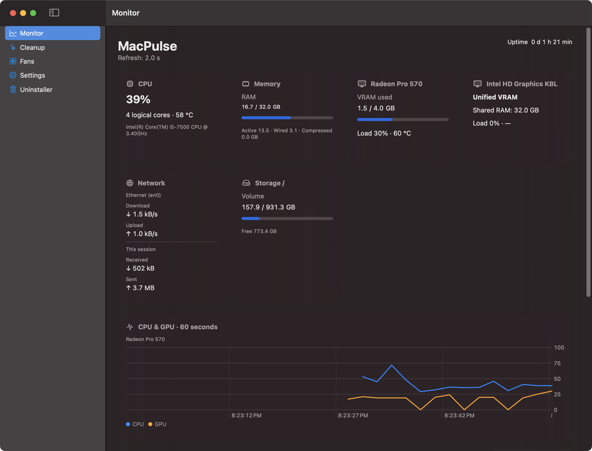
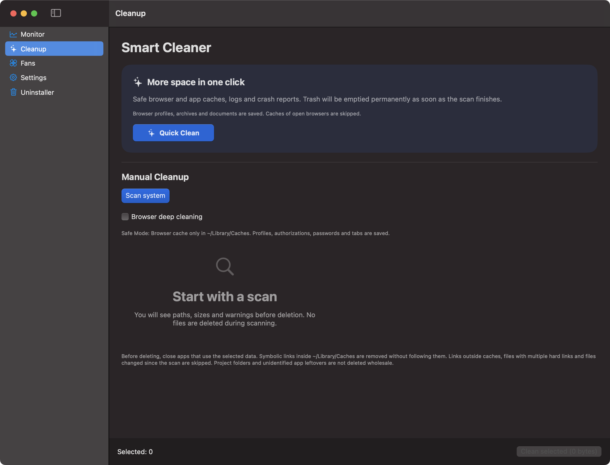
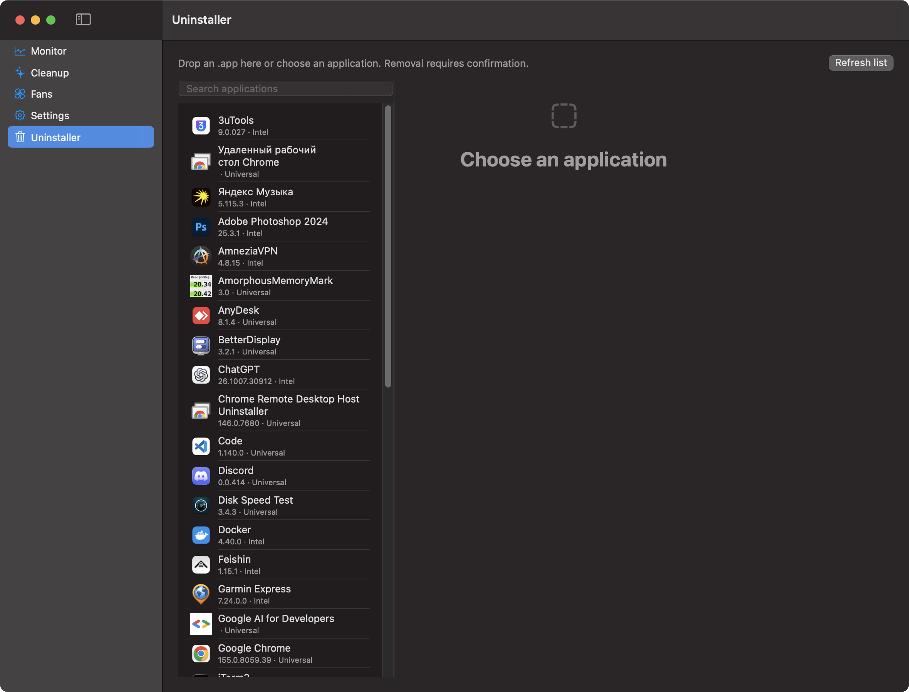
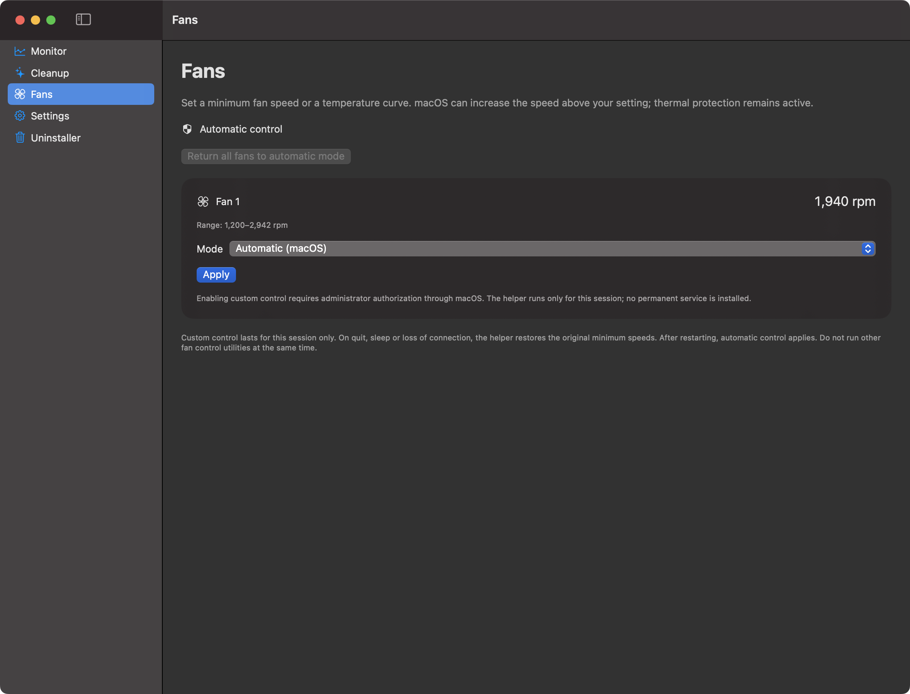

<div align="center">
  
  <h1>MacPulse</h1>
  <p><strong>The lightweight, all-in-one native macOS system suite.</strong></p>
  <p>System Monitor · Dual-GPU Tracker · Fan Controller · Smart Cleaner · App Uninstaller</p>
  
  
  
  <a href="https://github.com/makskondrasov9-dev/MacPulse/actions/workflows/ci.yml"></a>
  <a href="LICENSE"></a>
  <p><a href="https://github.com/makskondrasov9-dev/MacPulse/releases/latest/download/MacPulse.dmg"><strong>Download MacPulse.dmg</strong></a> · <a href="#install">Install</a> · <a href="#русский">Русский</a> · <a href="CHANGELOG.md">What's new</a></p>
</div>

MacPulse brings your Mac's everyday maintenance tools together in one Swift + SwiftUI app. See what is busy, inspect both GPUs, watch network traffic, manage supported fans, review caches and uninstall apps — without a subscription or an account.

Built on an Intel iMac 2017, with Universal binaries for modern Apple Silicon and older Intel Macs running macOS 13 or later. **Free under MIT. No telemetry, advertising or paid feature tiers.** Version **1.0.0** adds floating desktop HUDs, per-process network connections and event-driven foreground app usage, retaining macOS Ventura support.



## Your Mac, in one window

| Module | What you get |
| --- | --- |
| **System Monitor** | CPU, RAM, top processes with descriptions and confirmed termination, storage, network rates and session totals. Battery information appears on laptops. |
| **Multi-GPU** | Separate AMD and Intel cards, detected VRAM capacity, shared-memory reporting on integrated GPUs and Apple Silicon. No hard-coded 4 GB limit. |
| **Menu bar** | Classic text, compact text, 12-point sparklines or charts + text. Choose metrics, local/public IP and a VPN/tunnel indicator. |
| **Fans** | Automatic mode, minimum RPM and temperature-dependent curves on supported Intel hardware, with an explicitly authorized helper. Fanless Macs hide this section. |
| **Smart Cleaner** | Browser cache, video/audio/development/game caches, logs and more. Manual preview and category selection, plus Quick Clean. |
| **App Uninstaller** | Installed-app list, drag & drop, related-file sizes and individual checkboxes. Protects system apps, running apps, MacPulse and shared data used by duplicate installations. |
| **Storage Health** | Available SMART status, SSD life and lifetime writes on supported NVMe and Samsung 860/870 EVO drives. |
| **Diagnostics** | Cancellable 1 GB disk benchmark, CPU and Metal GPU stress tests, full-screen pixel inspector and native networkQuality speed testing. |
| **Insights & identity** | Session peaks, opt-in foreground-app time, local IP/MAC, optional public-IP history and a compact network view that hides service-only interfaces. |
| **Native integration** | System/light/dark appearance, launch at login, 1–3 second polling and 12 languages including Arabic RTL. |

**Hardware support is capability-based.** Apple Silicon fan control is currently read-only; system-wide GPU utilization and numeric CPU temperature are not available there through the implemented public fallback. Its thermal state is shown instead. SMART may be unavailable through USB adapters or multi-store configurations. Unknown readings are hidden, not invented. Universal compilation is not a claim that every M1–M4 or Intel model has been physically tested.

## How it compares

Choose by the job you need done. This is a scope comparison, not a performance benchmark or a claim of feature parity.

| App | Price / model | Open source | Main focus |
| --- | --- | --- | --- |
| **MacPulse** | **Free; no subscription** | **MIT** | **Monitoring + supported fan control + cleaning + app removal** |
| [CleanMyMac](https://macpaw.com/store/cleanmymac) | From **US$39.95/year** for one Mac; other plans available | Proprietary | Maintenance, cleanup and app management; additional protection features |
| [iStat Menus](https://register.bjango.com/mac/istatmenus/) | Paid license; see regional checkout | Proprietary | Detailed menu-bar monitoring, sensors and fan controls |
| [Macs Fan Control](https://crystalidea.com/macs-fan-control/download) | **Free core**, optional [paid Pro](https://crystalidea.com/macs-fan-control/buy) | Proprietary | Dedicated fan and temperature controls |
| [AppCleaner](https://freemacsoft.net/appcleaner/) | **Free** | No open-source license advertised | Focused app removal |

Vendor pages checked 12 October 2026. Taxes, region, promotions and upgrades can change prices. See vendor checkout pages for current regional pricing. iStat Menus also supports macOS 13+. MacPulse is a smaller, developing project; hardware coverage and specialized tools differ.

## Take a look

<table>
<tr><td><strong>Smart Cleaner</strong><br></td><td><strong>App Uninstaller</strong><br></td></tr>
<tr><td colspan="2"><strong>Fan controls</strong><br></td></tr>
</table>

**A small menu-bar footprint:**


These are real interface captures from an Intel iMac, using live readings. [Reproduce the screenshots](docs/screenshots/README.md).

## Install

### Download the DMG

1. Download **[MacPulse.dmg](https://github.com/makskondrasov9-dev/MacPulse/releases/latest/download/MacPulse.dmg)** from GitHub Releases.
2. Open the DMG and drag **MacPulse** into **Applications**.
3. Open MacPulse. Click its menu-bar item to open the dashboard.

Requires **macOS 13 Ventura or later**. One DMG contains `x86_64` and `arm64`. To update, quit the previous copy before replacing it; preferences are preserved. Release assets include `SHA256SUMS`.

### Gatekeeper / first launch

The app is ad-hoc signed, **without Developer ID signing or Apple notarization**. For a verified download from this repository, try **right-click → Open** on Ventura/Sonoma. If macOS still blocks it, attempt to open it and then use **System Settings → Privacy & Security → Open Anyway**. See [Apple's instructions](https://support.apple.com/102445); the exact flow varies by macOS version.

If you intentionally choose the Terminal route after checking the source and checksum, this clears extended attributes, including quarantine, only from the installed MacPulse bundle:

```sh
xattr -cr /Applications/MacPulse.app
open /Applications/MacPulse.app
```

This removes a download protection marker; it does not notarize the app or repair a genuinely damaged download. Do not disable Gatekeeper system-wide.

### Homebrew — project-maintained cask

```sh
brew tap makskondrasov9-dev/macpulse https://github.com/makskondrasov9-dev/MacPulse.git
brew install --cask makskondrasov9-dev/macpulse/macpulse
```

On Homebrew versions that require explicit trust for third-party casks, review [Casks/macpulse.rb](Casks/macpulse.rb), then run `brew trust --cask makskondrasov9-dev/macpulse/macpulse` before installation. This is **our own tap**, not an accepted entry in the official `homebrew/cask` repository. Homebrew has its own host-OS support policy; DMG installation does not depend on Homebrew.

## Cleanup, permissions and privacy

- Manual cleanup and app removal show selected paths before confirmation. Review them: application data may include projects and settings.
- **Quick Clean permanently empties accessible Trash items** along with eligible caches and logs. It begins deletion after scanning. Use manual cleanup when you want to choose categories.
- Safe browser mode excludes profiles, cookies and sessions; deeper cleaning requires confirmation. Open applications can cause skips.
- Full Disk Access is optional for monitoring. Cleaner and uninstaller access remains subject to macOS permissions; inaccessible items are reported. The Settings indicator is a heuristic, not an authoritative permission API.
- Fan overrides are session-based. A separate helper requires administrator approval; normal monitoring and app removal do not elevate privileges. macOS thermal protection remains active.
- Public-IP history is opt-in and queries ipify once per minute; the service receives your public IP. Network speed tests use Apple’s networkQuality servers and transfer data. Foreground-app time is opt-in and stored locally.
- There is no telemetry service or account. File operations remain local. App removal does not guarantee discovery of every third-party helper or shared file.

## Languages

| Language | Native name | Locale |
| --- | --- | --- |
| English | English | en |
| Russian | Русский | ru |
| Spanish | Español | es |
| French | Français | fr |
| German | Deutsch | de |
| Portuguese (Brazil) | Português (Brasil) | pt-BR |
| Italian | Italiano | it |
| Chinese (Simplified) | 简体中文 | zh-Hans |
| Japanese | 日本語 | ja |
| Korean | 한국어 | ko |
| Arabic | العربية | ar |
| Hindi | हिन्दी | hi |

Switch languages immediately in Settings or follow the system language. Translations were prepared with AI assistance and terminology edits; native-speaker reviews are welcome.

## Flagship features in 1.0.0

- **Desktop HUDs:** three draggable translucent panels for CPU/GPU sparklines, RAM/disk and network speed. Pin them above the wallpaper or float above windows. Adjust opacity (40–100%), enable click-through, and restore positions on relaunch.
- **Process network monitor:** a dedicated Network section lists visible TCP/UDP sockets with PID, app icon, local/remote endpoint and state. Search by app or port and filter remote connections. Polling runs only while this section is open; macOS permissions determine which sockets are visible.
- **Screen Time Lite:** local, opt-in top-five foreground app usage with colored bars. Activation notifications split time between apps; idle and sleep gaps are excluded. No window titles or document names are recorded.
- **Session records:** CPU temperature with its peak timestamp, maximum RAM and peak GPU utilization.

## Also included

- Uninstaller sorting by size, name and last use; filters for unused and unsigned apps.
- Spotlight last-use dates with a clearly identified modification-date fallback.
- Local code-signature validation (Apple / Developer ID, Ad-Hoc, unsigned or invalid). Signature validity does **not** prove notarization.
- On-demand GitHub update checks, release notes and a DMG download button.
- Six persistent accent colors, translated into all 12 supported languages.

## Diagnostics in 0.9.0

[Hardware diagnostics and analytics](docs/DIAGNOSTICS.md): cancellable disk/CPU/Metal tests, a display inspector, networkQuality, opt-in public-IP history and foreground-app usage, plus session peaks. IP and tunnel indicators are also available in Monitor and the menu bar. Technical network details and unavailable values can be shown or hidden. A tunnel indicator does not guarantee VPN protection of all traffic.

## Build and contribute

Swift 6, SwiftUI, Charts, Mach/Darwin, IOKit and Swift Package Manager. A compatible Swift 6 toolchain is required for development; its host requirements differ from the app's macOS 13 deployment target.

```sh
swift build
swift test
bash scripts/build-app.sh
bash scripts/package-dmg.sh
```

For mixed-version Command Line Tools installations, use `bash scripts/swift-local.sh build` and `bash scripts/swift-local.sh test`. The **112-test suite** (106 default checks plus six hardware opt-ins) covers metrics, localization, process control, fan policy, cleaner safety, uninstaller safety, sparklines and SMART decoding. Deletion tests use temporary fixtures. Runtime testing on Ventura and additional Mac models is welcome; the Ventura target has been compiled here, while local runtime checks used Sonoma.

[Development](docs/DEVELOPMENT.md) · [Uninstaller architecture](docs/UNINSTALLER.md) · [Report an issue](https://github.com/makskondrasov9-dev/MacPulse/issues) · [MIT license](LICENSE)

If MacPulse is useful to you, a GitHub star helps others find it. Reports with your Mac model, macOS version and a reproducible example help even more.

## Русский

**MacPulse — бесплатный нативный набор инструментов для Mac на Swift и SwiftUI.** Мониторинг CPU, RAM, нескольких GPU и сети, управление поддерживаемыми вентиляторами, очистка и удаление приложений собраны в одном окне. Без подписок, рекламы и телеметрии; исходники под MIT.

Проект вырос из утилиты для iMac 2017. Версия **1.0.0** добавляет три плавающих виджета, таблицу TCP/UDP-соединений процессов, цветные шкалы времени использования программ и время достижения температурного пика. Диагностика, очистка, деинсталлятор и все прежние возможности сохранены. Минимальная система — **macOS 13 Ventura**. Universal DMG работает на архитектурах Intel и Apple Silicon, но доступность датчиков зависит от модели. Управление вентиляторами Apple Silicon пока только для чтения; неподдерживаемые SMART-показания скрываются. Проверка целевой версии компилятором пройдена, отдельный запуск на Ventura ещё требует проверки.

**[Скачать установщик](https://github.com/makskondrasov9-dev/MacPulse/releases/latest/download/MacPulse.dmg)** → открыть DMG → перетащить MacPulse в «Программы». Перед обновлением завершите старую копию. Для Homebrew используйте команды из раздела Install выше.

Пока нет Developer ID и нотариального заверения Apple. Для доверенной загрузки попробуйте правую кнопку → «Открыть»; при блокировке — «Системные настройки → Конфиденциальность и безопасность → Всё равно открыть». Альтернатива после проверки источника и контрольной суммы: `xattr -cr /Applications/MacPulse.app`. Команда удаляет расширенные атрибуты только приложения; отключать защиту всей macOS не требуется.

«Быстрая очистка» без дополнительного выбора удаляет доступный кэш, логи и содержимое Корзины. Для просмотра путей и выбора используйте ручной режим. Деинсталлятор запрашивает подтверждение: проверьте данные и проекты перед удалением. Full Disk Access для мониторинга не нужен.

Будем рады проверкам на Ventura, другим моделям Mac, улучшениям переводов и предложениям через Issues. Если проект полезен — поддержите его звездой.
