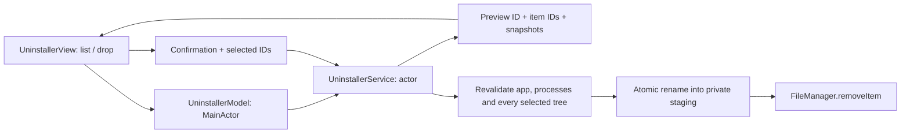

# Uninstaller architecture / Архитектура деинсталлятора

## Responsibilities

- `UninstallerService` discovers `/Applications` and `~/Applications`, validates dropped bundles, reads plist/Mach-O metadata without launching code and owns the saved preview. The public removal API accepts preview and item UUIDs, not deletion paths.
- `UninstallerTree` traverses directory descriptors with `O_NOFOLLOW` and records inode, device, type, size and modification/change timestamps for every entry. Internal symlinks are recorded but never traversed. A changed or added file invalidates the selection before deletion starts.
- Removal claims the exact root using `renameatx_np(RENAME_EXCL)` into a private staging directory on the same filesystem, checks the snapshot again, then calls `FileManager.removeItem`. Failed operations attempt to restore the remaining item; if restoration cannot happen, the recovery path is reported. Recursive removal can fail partway; the reported removed byte total includes only completely removed items and is not a measurement of newly free disk space.
- `UninstallerModel` maintains UI state and cancellable work. `UninstallerView` handles app icons, drag/drop, checkboxes, the itemized preview and the final confirmation. No app is killed automatically and no root helper is used.

## Matching and boundaries

Exact bundle-ID matches are checked in the user's `Library/Application Support`, `Caches`, `Preferences`, `Saved Application State`, `Containers`, `HTTPStorages` and `WebKit`. Name matches are confined to `Application Support`, start unchecked and exclude known generic vendor folders and collisions with other discovered apps.

System paths, Apple bundle IDs, nested helper bundles and MacPulse itself are protected. Arbitrary dropped files must be real `.app` directories with a valid APPL plist and bundle ID. A dropped bundle can be on another volume if the user can read and remove it; symlinked parents are rejected. Fixed macOS `/var`, `/tmp` and `/etc` aliases are mapped to `/private` for descriptor traversal, without resolving user-controlled links.

Two installed copies with the same bundle ID prevent shared-data removal. Running-app identity is checked through NSWorkspace and executable paths from libproc, before preview and again before removal. This reduces accidental removal of open apps; another process can still launch after the last check. Users should close related apps before uninstalling.

No fuzzy recursive vendor-prefix matching, Group Containers, LaunchAgents or system-wide Library cleanup is performed. Bundle IDs and names cannot establish ownership of every possible file. The preview is therefore a reviewable set of candidates, not a guarantee of residue-free removal.

## Точки входа

- Список приложений: `try await service.applications()`.
- Предпросмотр: `try await service.preview(applicationURL: url)`.
- Удаление после подтверждения: `try await service.remove(previewID: scan.id, selected: ids, confirmed: true)`.

Перед первой операцией проверяется весь выбранный набор. При ошибке удаления самого `.app` данные приложения остаются нетронутыми. Пользователь может отменить сканирование или остановить удаление между объектами; уже удалённые файлы восстановить нельзя.

## Menu bar and SMART

`MenuBarDisplayMode.resolve` migrates existing `full` and `compact` values without changing preferences. Four modes use the existing `menuBarTextStyle` key. `showCPUChart` and `showNetworkChart` are independent; text metrics keep their existing toggles. The default remains classic text. `SparklineGeometry` takes only the last 12 ticks; `SparklineView` draws a 22×12 point Path with no animations or independent timer. For MenuBarExtra the tiny Path is rendered to a template NSImage at the sampling cadence, retaining native light/dark tinting. CPU uses a 0–100% scale, network uses a local maximum. Missing values break the line.

`StorageHealthService` runs a read-only IOKit SMART probe on a utility task every five minutes. It follows only boot-volume ancestors from DiskArbitration, without borrowing results from another physical disk. The C bridge uses Apple's SDK `ATASMARTLib.h` and `NVMeSMARTLibExternal.h`; it never enables SMART, writes settings or starts self-tests. Unsupported multi-store/adapter configurations are hidden. NVMe life uses percentage-used and its 128-bit Data Units Written counter; ATA wear/write attributes are restricted to Samsung 860/870 EVO models.

Sources: [Apple SMART interface](https://developer.apple.com/documentation/iokit/ioatasmartinterface), [Samsung SMART attributes](https://semiconductor.samsung.com/resources/white-paper/Samsung_SSD_White_Paper.pdf), [NVMe specification](https://www.nvmexpress.org/wp-content/uploads/NVM-Express-Base-Specification-2.0c-2022.10.04-Ratified.pdf).
